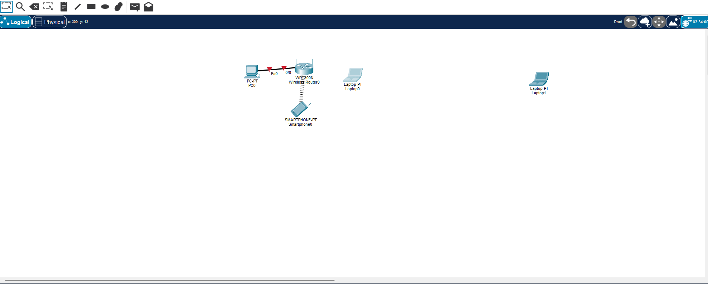
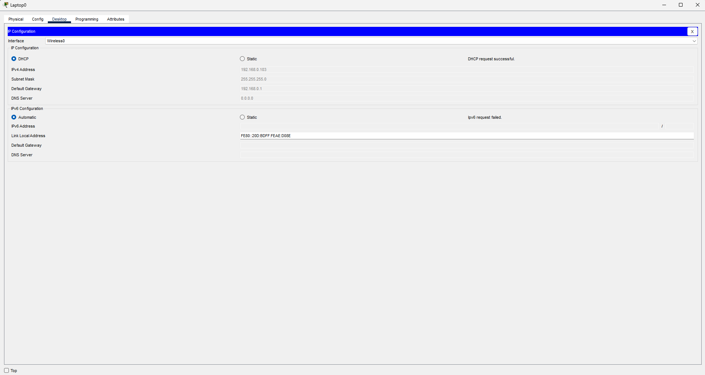
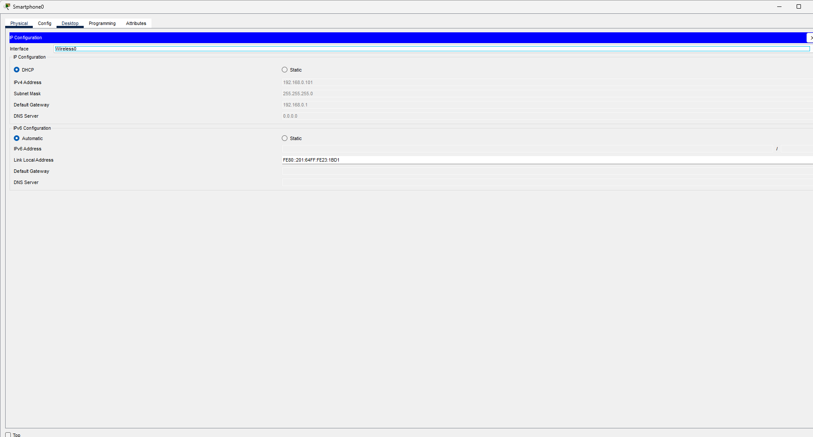
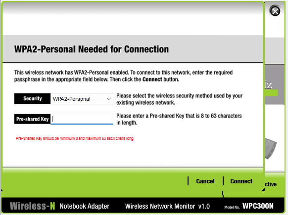
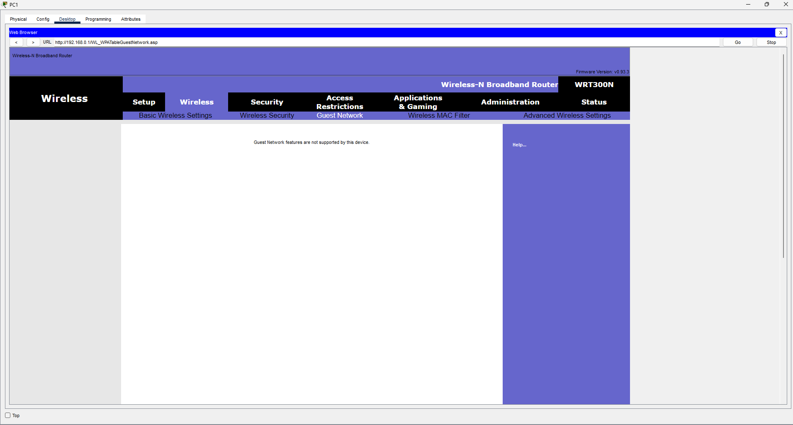

# Лаба 2 — Захищена домашня мережа (WiFi hardening + загрозна модель)

**Платформа:** Cisco Packet Tracer
**Тема:** бездротова безпека, укріплення периметра, оцінка реальних vs уявних захистів, залишковий ризик
**Пристрої:** 1× бездротовий роутер WRT300N · 1× ПК (кабель) · 1× ноутбук + 1× смартфон (WiFi) · 1× «чужий» ноут (порушник)

---

## 🎯 Мета

Зібрати звичайну домашню мережу (дротовий ПК + ноутбук і смартфон по WiFi) і **захистити її шарами** від сторонніх і від проникнення. Головний акцент — не кількість увімкнених опцій, а **чесна оцінка, що реально захищає, а що лише створює тертя**, плюс документування залишкового ризику.

---

## 🧭 Топологія та адресація

Один бездротовий роутер WRT300N (роутер + світч + точка доступу + DHCP в одній коробці). Плоска мережа `192.168.0.0/24`, шлюз `192.168.0.1`. DHCP-пул обмежено до **8 адрес** (`.100`–`.107`).

| Пристрій | Підключення | Адреса |
|----------|-------------|--------|
| ПК | кабель (LAN-порт) | 192.168.0.100 |
| Смартфон | WiFi | 192.168.0.101 |
| Ноутбук | WiFi | 192.168.0.103 |
| «Чужий» ноут | WiFi (спроба) | — (заблоковано) |

---

## 🛡️ Захисні заходи — і їхня чесна вага

Ключова ідея лаби: **не всі «захисти» рівноцінні.** Розділяю їх прямо.

### Реальні бар'єри (застосовано, працюють)
1. **WPA2-Personal + AES** на мережі `Homenet.lab` + сильна **згенерована** пасфраза. Головний гейт мережі. Шифрує трафік і закриває вхід. AES (не TKIP), бо TKIP застарів.
2. **Змінено пароль адмінки роутера** (з дефолтного). Окремий секрет від WiFi-пароля — щоб знання WiFi-пароля не давало контролю над роутером. Дефолтний `admin` — одна з найексплуатованіших дірок (ботнети сканують саме на це).
3. **Remote Management вимкнено.** Адмінку не видно з боку інтернету, тільки зсередини мережі.
4. **DHCP-пул обмежено до 8.** Гігієна: менше вільних адрес для чужого пристрою. Вторинний шар, не стіна.

### Обскюріті (театр безпеки — свідомо НЕ покладаємось)
- **Приховування SSID** і **MAC-фільтр** — задумані як додаткові шари, але **навмисно не стали основою захисту**, бо обходяться знаючим атакувальником за хвилини: прихований SSID усе одно видно в ефірі, а MAC-адреси летять у WiFi-кадрах відкритим текстом (навіть при WPA2) і легко підробляються.
- **MAC-фільтр** додатково впершись у баг PT (поле MAC відхиляло запис за форматом/довжиною), тому не зберігся. Але оскільки це обскюріті, **на реальну безпеку мережі це не впливає** — вона тримається на WPA2 + укріпленні адмінки.

> **Висновок цього розділу:** мережа захищена **реальними** контролями, а не театром. Свідоме рішення не спиратись на SSID-hiding/MAC-фільтр — це і є різниця між «наліпив галочок» і «розумію, що працює».

---

## ✅ Перевірка (критерії)

| # | Критерій | Результат |
|---|----------|-----------|
| 1 | Свої пристрої отримують IP по DHCP | ✅ ноут `.103`, смартфон `.101`, ПК `.100` |
| 2 | Мережа закрита WPA2 (не відкрита, не WEP) | ✅ WPA2-Personal + AES |
| 3 | Адмінка роутера не на дефолтному паролі | ✅ змінено, Remote Mgmt off |
| 4 | Сторонній не може проникнути | ✅ див. демо нижче |

---

## 🎯 Демо проникнення (перевірка оборони на міцність)

«Чужий» ноут (Laptop1) намагається підключитись до мережі **без пасфрази**:

1. При спробі зайти йому вискакує вимога **«WPA2-Personal Needed for Connection»** — мережа одразу вимагає Pre-shared Key. Без нього асоціація не проходить.
   
2. Результат: на чужому ноуті **IP-адреси немає** (IPv4 порожній, шлюз `0.0.0.0`) — DHCP нічого не видав, бо пристрій не пройшов автентифікацію.
   

**Висновок демо:** периметр тримає на WPA2. Без пасфрази сторонній не отримує навіть мережевої адреси — отже, до ресурсів мережі не дістанеться. Це доказ оборони, а не лише твердження про неї.

---

## ⚠️ Відомі обмеження / залишковий ризик (свідомо задокументовано)

Мережа **плоска — внутрішньої сегментації немає.**

- **Поточна експозиція низька:** у мережі лише довірені особисті пристрої (ПК, ноут, телефон), контрольовані й оновлювані. Ізоляція між ними не потрібна.
- **Тригер зростання ризику:** додавання **IoT** або гостьових пристроїв. Слабка, рідко патчена «розумна» річ (камера, ТВ) у плоскій мережі стає трампліном — зламана камера дістає ноут (lateral movement).
- **Апаратне підтвердження обмеження:** цей роутер **не підтримує гостьову мережу** — тобто ізолювати гостей/IoT тут **нема чим**. Вони неминуче ділили б LAN із довіреними пристроями.
  
- **Мітигація:** перед введенням таких пристроїв винести їх в ізольований сегмент (окремий VLAN / гостьова мережа) з правилом фаєрвола IoT→LAN = deny. Тобто розширити до підходу з [[Лаби 1]] на керованому залізі.
- Так само обмеження пулу до 8 означає, що «гості на основній мережі» — це свідомий компроміс (недовірені пристрої на довіреному LAN), а не ідеал.

---

## 🌐 Що зробив би в реальній мережі (поза межами PT)

Контролі, яких симулятор не дає, але які є в реальному арсеналі:
- **WPA3** замість WPA2 — стійкіший до офлайн-брутфорсу (SAE-handshake).
- **Вимкнути WPS** — WPS-PIN брутфорситься, відома діра.
- **Вимкнути UPnP** — щоб пристрої не відкривали порти назовні самі (у PT поле залочене).
- **Оновити прошивку роутера** — стара прошивка = відомі CVE (у PT оновлення недоступне).
- **DNS-фільтрація** (Quad9 / Cloudflare for Families) — ріже шкідливі домени.
- **Доступ до адмінки лише по кабелю** (вимкнути admin-over-WiFi) — у PT поле залочене.
- **Сегментація IoT/гостей** в окремий VLAN — закриває головний залишковий ризик.

---

## 🔐 Гігієна секретів

- Пасфразу згенеровано **випадково** (а не придумано) — випадковий пароль не вгадати словниковою атакою, що й закриває головну слабкість WPA2-PSK (офлайн-брутфорс слабких паролів).
- Пароль адмінки — **окремий** від WiFi-пароля (не переvикористовувати секрети).
- У продакшені обидва зберігалися б у **менеджері паролів**, а на будь-яких скрінах/у документації — **заредаговані** (`********`). Реальний WiFi/адмін-пароль у публічному репо = роздати ключ від мережі всьому інтернету. У цій лабі секрети викидні (симуляція), тому показані.

---

## 🧾 Висновок

Домашня мережа захищена **реальними** контролями — WPA2-AES із випадковою пасфразою, зміненою адмінкою та вимкненим віддаленим керуванням — і це підтверджено демонстрацією: сторонній без пасфрази не отримує навіть IP. Свідомо **не покладаюсь** на обскюріті (прихований SSID, MAC-фільтр), бо вони лише створюють тертя. Головне обмеження — відсутність сегментації — чесно задокументовано разом із тригером (IoT) і шляхом мітигації. Різниця між захищеною й «ніби захищеною» мережею тут не в кількості галочок, а в розумінні, яка з них чого варта.
