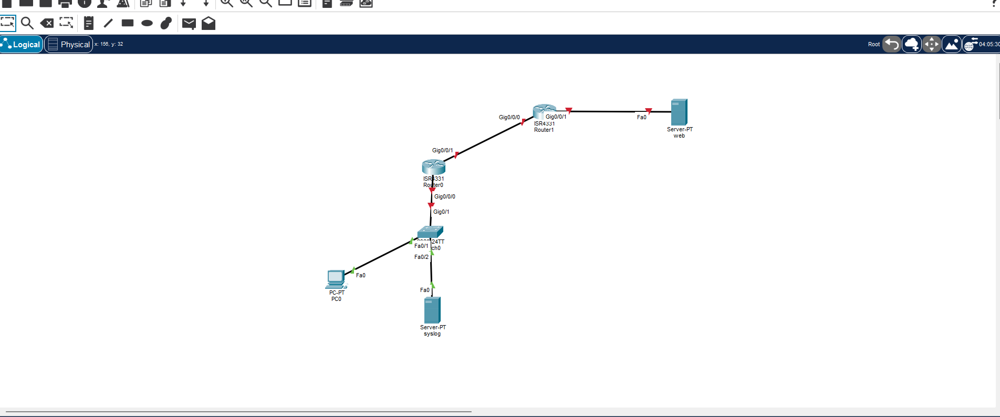
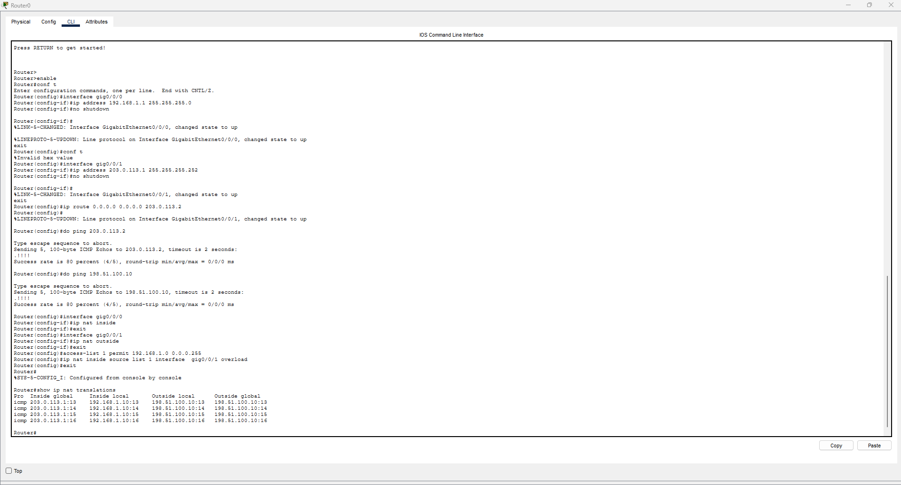
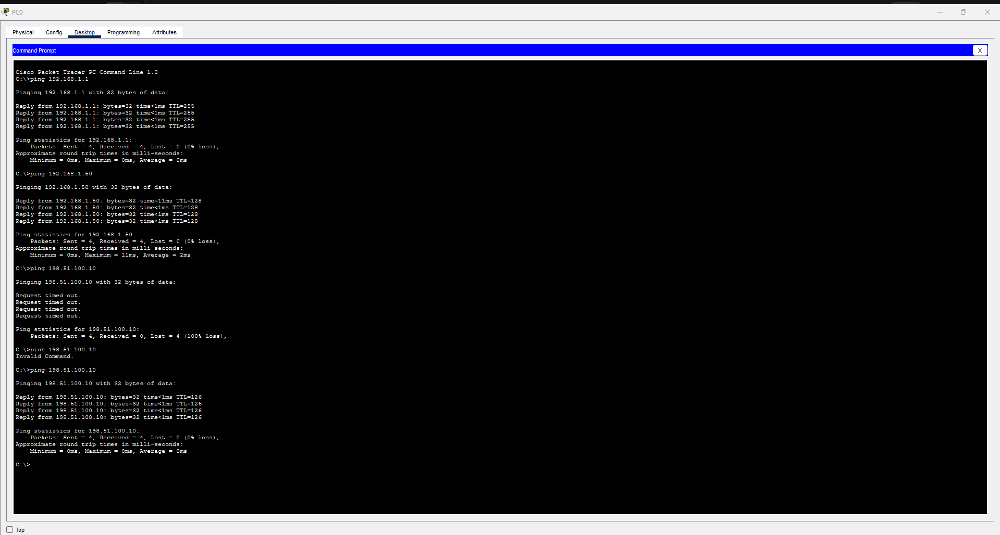
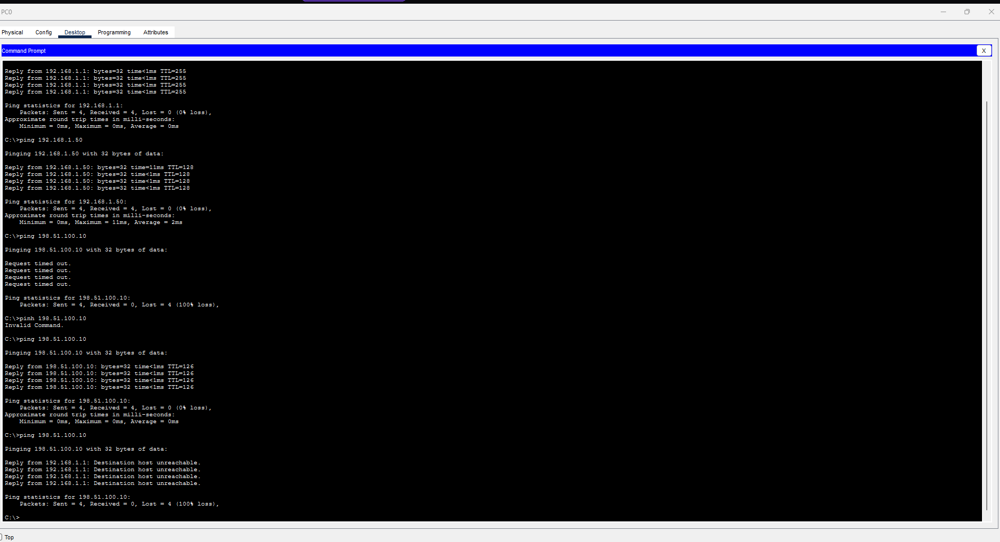
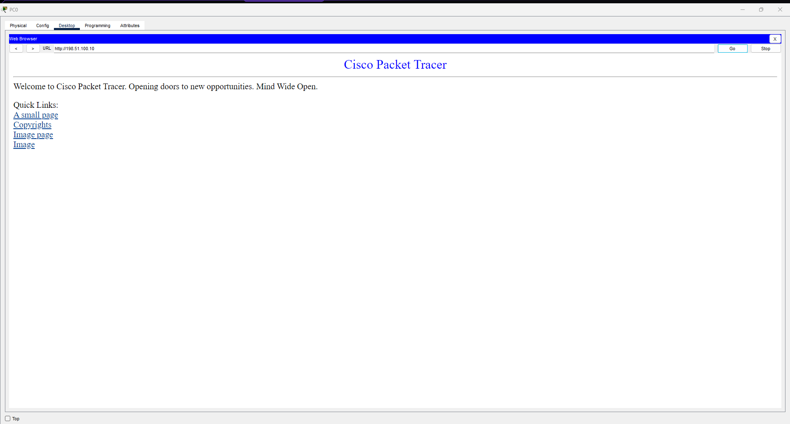
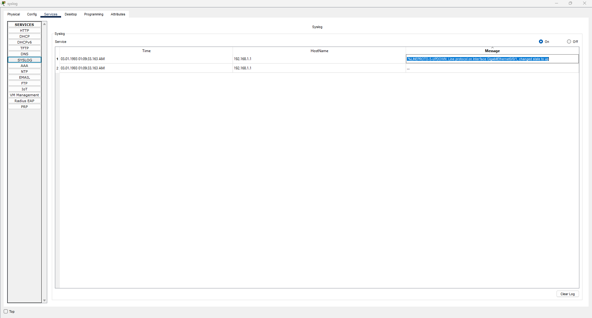

# Лаба 3 — Периметр мережі (NAT + ACL + Syslog)

**Платформа:** Cisco Packet Tracer
**Тема:** крайовий роутер як периметр — трансляція адрес, фільтрація трафіку, централізоване логування
**Пристрої:** 2× роутер ISR4331 (R1 крайовий, R2 «ISP») · 1× світч 2960 · 1× ПК · 1× Syslog-сервер · 1× Web-сервер

---

## 🎯 Мета

Налаштувати крайовий роутер як **периметр мережі** — межу між внутрішнім офісом і «інтернетом». Периметр робить три речі, які стоять на межі будь-якої реальної мережі:
1. **NAT** — ховає приватні адреси офісу за однією публічною;
2. **ACL** — вирішує, якому трафіку можна проходити, а якому ні;
3. **Syslog** — шле події роутера на централізований лог-сервер.

---

## 🧭 Топологія та адресація

Внутрішній офіс (`192.168.1.0/24`) виходить у «інтернет» через R1. R2 грає роль провайдера; за ним — Web-сервер як «сайт в інтернеті».



| Пристрій / інтерфейс | Адреса | Роль |
|---|---|---|
| Внутрішня LAN | `192.168.1.0/24` | офіс |
| R1 Gig0/0/0 (в офіс) | `192.168.1.1` | шлюз LAN, NAT inside |
| PC0 | `192.168.1.10` | станція |
| Syslog Server | `192.168.1.50` | лог-сервер |
| R1 Gig0/0/1 (на ISP) | `203.0.113.1 /30` | публічний бік, NAT outside |
| R2 Gig0/0/0 (до нас) | `203.0.113.2 /30` | ISP |
| R2 Gig0/0/1 (до сайту) | `198.51.100.1 /24` | ланка до web |
| Web Server | `198.51.100.10` | «сайт в інтернеті» |

> **Про адресацію (свідомо задокументовано):** публічні адреси призначено **статично**, бо R2 у лабі виконує роль провайдера — ми володіємо обома сторонами стику. У реалі публічна адреса прийшла б від ISP: статично за контрактом, або динамічно (`ip address dhcp` / PPPoE). Діапазони `203.0.113.0/30` і `198.51.100.0/24` — **документаційні** (RFC 5737), у справжньому інтернеті не маршрутизуються.

---

## 🛣️ Маршрутизація — дефолтний маршрут

На R1:
```
ip route 0.0.0.0 0.0.0.0 203.0.113.2
```
`0.0.0.0 0.0.0.0` = «будь-яка адреса» (маска з усіх нулів — жоден біт не важить). Це **маршрут за замовчуванням**: R1 знає напряму лише свої дві мережі, а все незнайоме (весь «інтернет») шле на R2. Роутер завжди вибирає найточніший збіг (longest-prefix match), тому дефолт `0.0.0.0/0` спрацьовує **останнім** — як запасний варіант для всього, що нікуди конкретно не підійшло. Реально прописати всі мережі інтернету неможливо, тому крайовий роутер тримає один дефолт «усе назовні → провайдеру».

> **Важливо:** зворотний маршрут до `192.168.1.0/24` на R2 **свідомо НЕ додано** — провайдер не повинен знати приватну мережу клієнта. Саме це створює проблему, яку вирішує NAT.

---

## 🔁 NAT — чому приватна мережа не доходить назовні

### Проблема (спершу побачили)
До NAT пінг з PC0 (`192.168.1.10`) на Web (`198.51.100.10`) **провалився** — `Request timed out`.

**Очікування vs реальність:** маршрутизація ж налаштована, чому не працює? Розбір показав — проблема на **зворотному шляху**. Запит доходить до Web нормально. Але Web намагається відповісти на `192.168.1.10`, а R2 такої мережі **не знає** (маршрут не додавали, провайдер її не має) → відповідь помирає на R2. Запит пішов — відповідь не вернулась.

### Рішення
NAT (режим **PAT / overload**) на R1:
```
interface gig0/0/0
 ip nat inside
interface gig0/0/1
 ip nat outside
access-list 1 permit 192.168.1.0 0.0.0.255
ip nat inside source list 1 interface gig0/0/1 overload
```
R1 на виході підміняє джерело `192.168.1.10` → `203.0.113.1` (своя публічна адреса). Web бачить запит від `203.0.113.1`, яку R2 знає, відповідає на неї — і R1 за таблицею трансляцій повертає відповідь правильному хосту. Приватна адреса ніколи не «світиться» назовні.

**PAT (overload):** багато внутрішніх пристроїв ділять одну публічну адресу, роутер розрізняє їх за портами — рівно те, що робить домашній роутер (уся хата за однією IP).

### Перевірка
Після NAT пінг з PC0 на Web проходить. Таблиця трансляцій підтверджує механізм:




> **Деталь на око:** TTL відповіді = 126 (стартові 128 мінус 2 хопи — R1 і R2). За TTL видно кількість роутерів на шляху.

---

## 🚦 ACL — гранульована фільтрація

### Принципи (ключ до розуміння)
1. **Згори вниз, перший збіг виграє** — щойно пакет збігся з правилом, рішення прийнято, далі список не читається.
2. **Неявний `deny any` у кінці** — що явно не дозволено, автоматично блокується.
3. **Standard (1–99)** дивиться лише на джерело; **Extended (100–199)** — на джерело + призначення + протокол + порти.
4. **Порядок вирішує все:** широке правило вище вузького — вузьке ніколи не спрацює.

### Правило
Задача: заборонити з офісу пінг (ICMP) до Web, але дозволити все інше (зокрема HTTP). На R1:
```
access-list 100 deny icmp 192.168.1.0 0.0.0.255 host 198.51.100.10
access-list 100 permit ip any any
interface gig0/0/0
 ip access-group 100 in
```
`deny` стоїть **вище** за `permit ip any any` — специфічне перед загальним. Застосовано на Gig0/0/0 у напрямку `in` (ловимо трафік там, де він *заходить* з офісу — ближче до джерела).

### Перевірка — гранульованість
- Пінг з PC0 на Web → **заблоковано** (`Destination host unreachable`).
- Сайт з PC0 у браузері (`http://198.51.100.10`) → **відкривається**.

ICMP зарізали, TCP/HTTP пропустили — фільтр ріже точково по протоколу, а не «все або нічого».




> **Діагностичний нюанс:** повідомлення змінилось із `Request timed out` (до NAT — відповідь зникала) на `Reply from 192.168.1.1: Destination host unreachable` (ACL-дроп — R1 **активно** відмовив і надіслав ICMP «не можна»). За цим у реальній діагностиці видно, що трафік ріже саме фільтр, а не впала маршрутизація.

---

## 📝 Syslog — централізоване логування

### Навіщо
Події роутера (інтерфейс впав, зміни конфігу) за замовчуванням живуть лише локально й зникають при перезавантаженні. Syslog шле їх на окремий сервер, де вони зберігаються централізовано.

### Конфіг (R1)
```
service timestamps log datetime msec
logging host 192.168.1.50
```
Логи йдуть на `192.168.1.50`, порт **514/UDP** (стандартний для syslog). Часові мітки — щоб кожна подія мала час (без часу лог для розслідування марний).

### Перевірка + важливий урок
**Очікування vs реальність:** першу спробу згенерувати подію зробив смиканням `gig0/0/0` (`shutdown`/`no shutdown`) — лог-сервер лишився **порожнім**. Причина: `gig0/0/0` — це саме той інтерфейс, через який syslog-трафік іде на сервер. Поки він у `shutdown`, доставка неможлива — шлях обірваний. Перемкнув подію на `gig0/0/1` (лінк на R2, до шляху «R1→syslog» не причетний) — події одразу дійшли:
`%LINEPROTO-5-UPDOWN: Line protocol on Interface GigabitEthernet0/0/1, changed state to up`



---

## ⚠️ Відомі обмеження / залишковий ризик (свідомо задокументовано)

1. **Час не синхронізований (NTP).** Мітки в syslog показують дефолтний годинник роутера (`1993`). Мітки є, але час неправильний. У реалі це критично: розсинхронений час між пристроями не дає SOC вибудувати хронологію атаки. Лікується **NTP**.
2. **ACL-logging недоступний у цьому білді PT.** Ключовий для SOC `log` на правилі `deny` додав би запис кожної заблокованої спроби в syslog (`%SEC-6-IPACCESSLOGDP: list 100 denied icmp ...`) — тобто видимість «хто куди стукав». У реальному IOS підтримується, але цей Packet Tracer команду відхиляє. Зафіксовано як бажане розширення поза межами симулятора.
3. **Публічні адреси статичні.** Призначено вручну, бо R2 виконує роль ISP (див. розділ про адресацію).

---

## 🧾 Висновок

Крайовий роутер налаштовано як повноцінний периметр: **NAT** ховає приватну мережу за однією публічною адресою (і доведено, чому без нього зворотний трафік не доходить), **ACL** фільтрує трафік точково по протоколу (пінг заблоковано, HTTP пропущено), **Syslog** шле події на централізований сервер. Обмеження (несинхронізований час, відсутність ACL-logging у PT) задокументовано разом зі шляхом їх усунення в реальній мережі.
