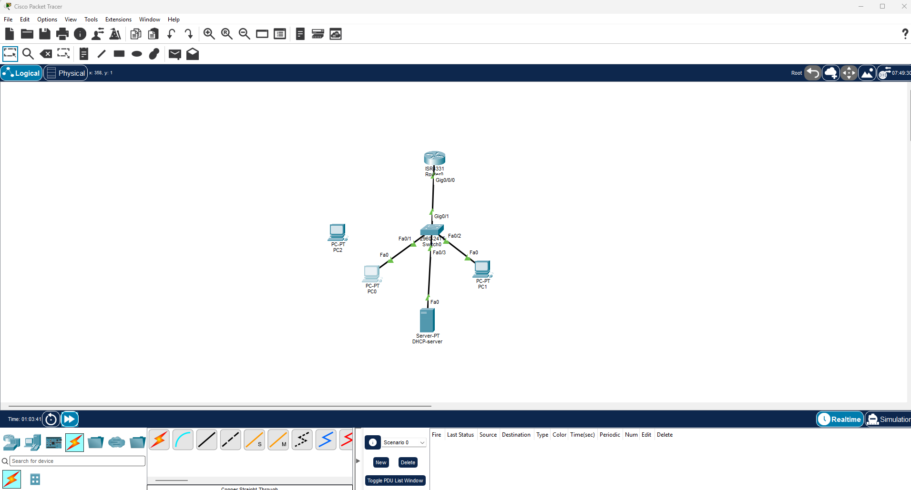
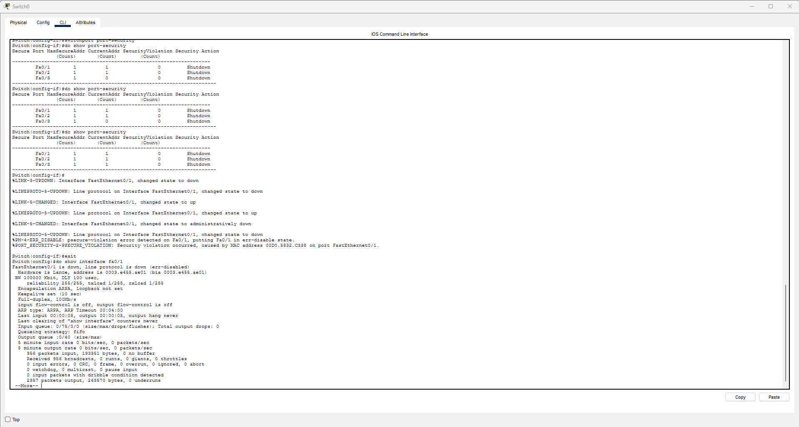
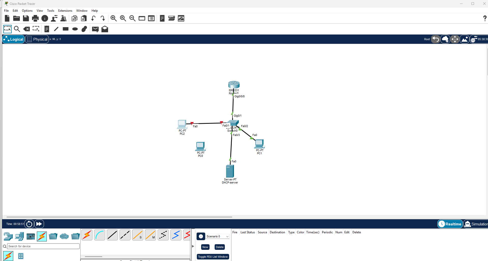
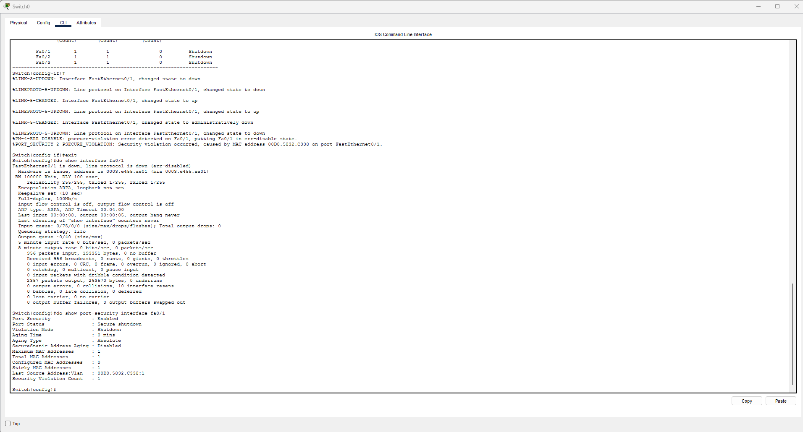
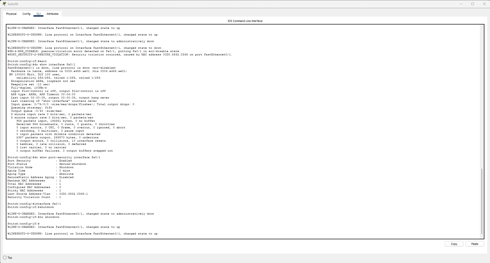
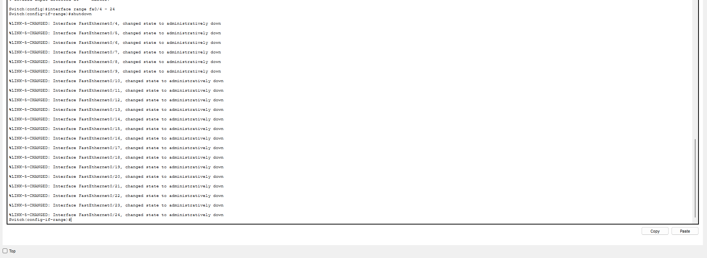
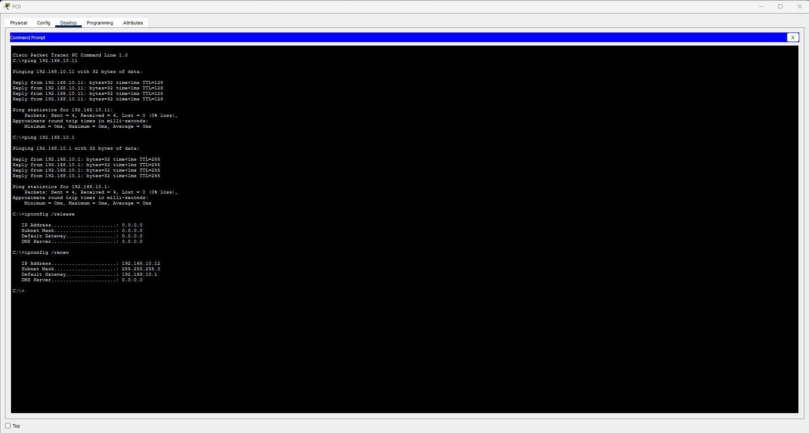
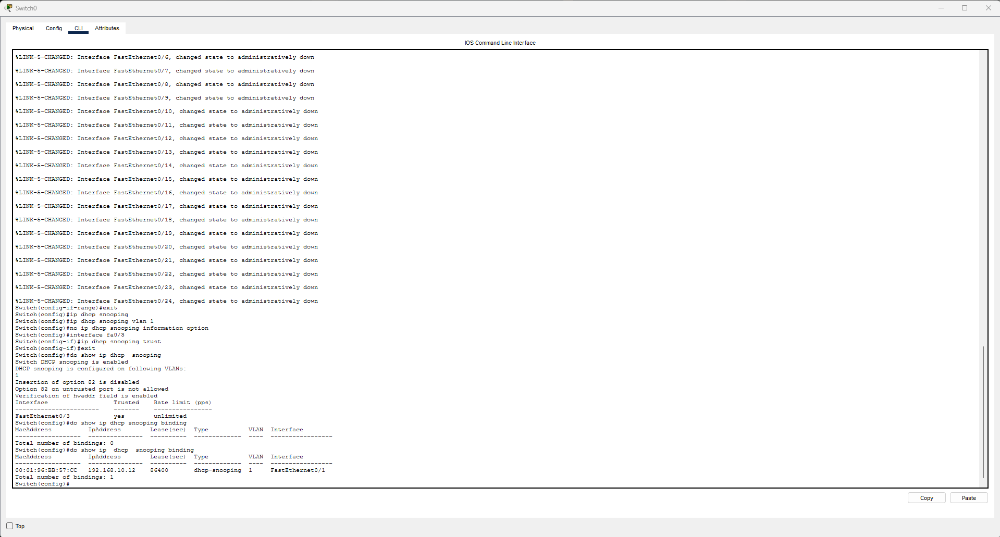
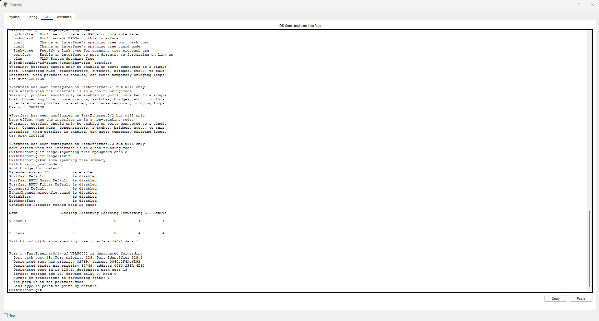

# Лаба 4 — Укріплення рівня L2 (Port Security + DHCP Snooping + BPDU Guard)

**Платформа:** Cisco Packet Tracer
**Тема:** захист доступового комутатора — контроль MAC на портах, захист DHCP, захист STP
**Пристрої:** 1× роутер ISR4331 (шлюз) · 1× світч 2960-24TT · 2× ПК · 1× сервер (DHCP) · 1× ПК-інтрудер

---

## 🎯 Мета

Налаштувати доступовий комутатор так, щоб контролювати, **хто** під'єднується до портів і **що** в них дозволено. Чотири контролі L2:
1. **Port Security** — один дозволений MAC на порт, чужий → порт падає;
2. **Shutdown невживаних портів** — закрити фізично вільні двері;
3. **DHCP Snooping** — дозволити DHCP-відповіді лише з порту справжнього сервера;
4. **BPDU Guard + PortFast** — не дати чужому комутатору втрутитись у STP.

---

## 🧭 Топологія та адресація

Внутрішня мережа `192.168.10.0/24`. Роутер — шлюз, сервер роздає адреси по DHCP, два ПК — легітимні клієнти. PC2 — інтрудер, фізично присутній, але не під'єднаний до робочого стану.



| Пристрій / інтерфейс | Адреса | Роль |
|---|---|---|
| Router Gig0/0/0 | `192.168.10.1 /24` | шлюз |
| Switch Gig0/1 | — | uplink до роутера |
| Server0 (Fa0/3) | `192.168.10.2` статична + DHCP | сервер + DHCP |
| PC0 (Fa0/1) | DHCP | клієнт |
| PC1 (Fa0/2) | DHCP | клієнт |
| PC2 | статична (для спроби) | інтрудер (MAC `00D0.5832.C338`) |

DHCP-пул на сервері: `serverPool`, default-gateway `192.168.10.1`, старт `192.168.10.10`, маска `/24`.

---

## 🔒 Port Security — один MAC на порт

### Конфіг (Fa0/1–0/3)
```
interface fa0/1
 switchport mode access
 switchport port-security
 switchport port-security maximum 1
 switchport port-security mac-address sticky
 switchport port-security violation shutdown
```
- `maximum 1` — не більше одного MAC на порту;
- `mac-address sticky` — порт сам вивчає MAC першого кадру й записує його як захищений;
- `violation shutdown` — при порушенні порт переходить у `err-disabled`.

### Очікування vs реальність — коли з'являється прив'язка
Після застосування `sticky` `show port-security` показав **Sticky MAC = 0**. Прив'язки ще не було — хоча правило вже стояло. Вона з'явилась (`Sticky MAC = 1`) лише **після першого кадру** з порту: `sticky` не знає MAC наперед, він записує його з першого трафіку. Те саме на Fa0/3: порт показував `CurrentAddr 0`, поки Server0 не надіслав кадр (пінг) **після** увімкнення port-security — старий трафік порт не бачив, прив'язка з'явилась з наступного кадру.

Після того як усі три порти побачили свій легітимний пристрій — зведена таблиця показала `MaxSecureAddr 1`, `CurrentAddr 1`, дія `Shutdown` на кожному:



### Демонстрація порушення
Легітимний PC0 від'єднано від Fa0/1, замість нього під'єднано інтрудера PC2:



**Очікування vs реальність — порушення тригериться кадром, не кабелем.** Саме під'єднання кабелю PC2 порт **не** поклало — лінк піднявся, порт лишався робочим. Порушення спрацювало лише коли PC2 спробував пінгнути шлюз: перший кадр (ARP) з чужим MAC не збігся з єдиним дозволеним sticky-MAC → порт упав. PC2 при цьому **не мав робочого з'єднання й не потребував його** — сама спроба вийти в мережу стала тригером, і порт заблокував її на L2, ще до будь-якої маршрутизації (`100% loss`).

Syslog зафіксував подію з адресою винного:
```
%PM-4-ERR_DISABLE: psecure-violation error detected on Fa0/1, putting Fa0/1 in err-disable state.
%PORT_SECURITY-2-PSECURE_VIOLATION: Security violation occurred, caused by MAC address 00D0.5832.C338 on port FastEthernet0/1.
```

Деталізація по порту підтверджує стан і джерело:



```
Port Status              : Secure-shutdown
Last Source Address:Vlan : 00D0.5832.C338:1
Security Violation Count : 1
```

### Відновлення порту
Порт в `err-disabled` сам не підніметься. Спершу прибрано причину (повернено PC0), потім перезапущено інтерфейс:
```
interface fa0/1
 shutdown
 no shutdown
```



**Очікування vs реальність — порядок дій.** Якби PC2 лишився в порту, `no shutdown` підняв би порт, і той одразу впав би знову на першому кадрі інтрудера — нескінченний цикл. Порт піднявся чисто саме тому, що sticky-прив'язка до MAC PC0 нікуди не зникала з конфігу: легітимний MAC збігся з наявним записом → `Secure-up`.

---

## ⛔ Невживані порти

Вільний непідключений порт — доступна точка входу. Усі невживані порти заглушено одним діапазоном:
```
interface range fa0/4 - 24
 shutdown
```



Fa0/4–0/24 у стані `administratively down` — фізичне під'єднання до них нічого не дає.

---

## 🛡️ DHCP Snooping — захист від підміни DHCP

### Механізм
Комутатор ділить порти на **trusted** (звідси дозволені DHCP-відповіді OFFER/ACK — порт справжнього сервера) і **untrusted** (дефолт; дозволені лише запити DISCOVER/REQUEST). OFFER/ACK з untrusted-порту → дроп (ознака підробного сервера). Паралельно будується **binding table** (MAC ↔ IP ↔ порт ↔ VLAN).

### Конфіг
```
ip dhcp snooping
ip dhcp snooping vlan 1
no ip dhcp snooping information option
interface fa0/3
 ip dhcp snooping trust
```
Trusted — лише **Fa0/3** (порт сервера). `no ... information option` вимикає вставку option-82: без цього комутатор додає її в кадри, сервер їх відкидає, і клієнти перестають отримувати адреси.

### Очікування vs реальність — порожня binding table
Одразу після увімкнення `show ip dhcp snooping binding` показав **0 записів**, хоча PC0/PC1 мали адреси. Причина: оренди було видано **до** увімкнення snooping — комутатор заносить у таблицю лише ті DORA-обміни, які спостерігав наживо, минулі він не бачив. Щоб наповнити таблицю, на PC0 примусово оновлено оренду:
```
ipconfig /release
ipconfig /renew
```



PC0 отримав `192.168.10.12` — цього разу обмін пройшов під наглядом (DISCOVER з untrusted Fa0/1, ACK з trusted Fa0/3), і запис з'явився:



```
MacAddress          IpAddress       Type            VLAN  Interface
00:01:96:BB:57:CC   192.168.10.12   dhcp-snooping   1     FastEthernet0/1
```

MAC `00:01:96:BB:57:CC` тут — той самий, що став sticky-MAC на Fa0/1 у Port Security: обидва механізми фіксують одну ідентичність пристрою з різних боків.

---

## 🌳 BPDU Guard + PortFast

### Механізм
- **PortFast** — на доступовому порту пропускає STP-стадії listening/learning, одразу `forwarding`. Лише для портів з кінцевими хостами.
- **BPDU Guard** — на PortFast-порт не має приходити жоден BPDU (там хост, не комутатор). Якщо BPDU прийшов → хтось під'єднав комутатор → порт у `err-disabled`. Закриває спробу чужого комутатора нав'язати себе кореневим (root bridge).

### Конфіг (Fa0/1–0/3)
```
interface range fa0/1 - 3
 spanning-tree portfast
 spanning-tree bpduguard enable
```

### Очікування vs реальність — де перевіряти
`show spanning-tree summary` показав `Portfast Default is disabled` — це **не** помилка. Ключове слово `Default`: ця команда показує **глобальні** налаштування, а конфіг зроблено **per-interface**. Стан порту видно іншою командою:
```
show spanning-tree interface fa0/1 detail
```



```
The port is in the portfast mode
```
PortFast активний на порту. Загальна зведена таблиця й стан конкретного порту — різні вікна.

---

## ⚠️ Відомі обмеження (свідомо задокументовано)

1. **Dynamic ARP Inspection (DAI) не реалізовано.** DAI логічно доповнює DHCP snooping (використовує його binding table, щоб відкидати підроблені ARP-відповіді й блокувати ARP-spoofing/MITM). У цьому білді Packet Tracer команди `ip arp inspection` приймаються, але фактичне відкидання підроблених ARP не забезпечується — демонструвати нічого. Зафіксовано як бажане розширення поза межами симулятора.
2. **BPDU Guard не показується окремим рядком** у `show spanning-tree interface ... detail` у PT. Команду прийнято без помилки; стан підтверджується наявністю в running-config та активним PortFast на тих самих портах.

---

## 🧾 Висновок

Доступовий комутатор укріплено на рівні L2: **Port Security** прив'язує по одному MAC на порт і демонстровано кладе порт у `err-disabled` при чужому MAC (з фіксацією адреси винного в syslog) та коректно відновлюється після усунення причини; **невживані порти** заглушено; **DHCP Snooping** довіряє DHCP-відповідям лише з порту сервера й веде таблицю прив'язок; **BPDU Guard + PortFast** захищають STP від чужого комутатора. Обмеження (DAI поза можливостями PT) задокументовано разом із його роллю в реальній мережі.
